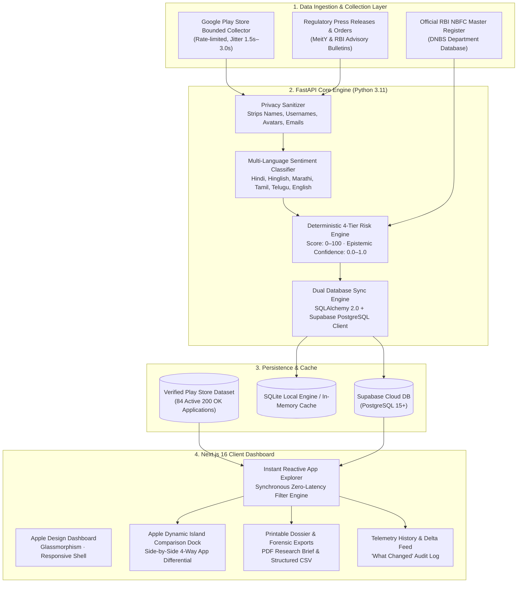

# 🛡️ Loan App Safety Checker

> **Real-Time Regulatory Intelligence & Heuristic Predatory Risk Engine for Digital Lending Applications**  
> Cross-referenced against the official **Reserve Bank of India (RBI) NBFC Master Register (DNBS)** and enriched with multi-language sentiment analysis.

[](https://frontend-vansh19.vercel.app)
[](https://loan-app-safety-checker-production.up.railway.app/docs)
[-3ECF8E?logo=supabase)](https://supabase.com)
[](https://python.org)
[](https://typescriptlang.org)
[](https://github.com/Vr838/loan-app-safety-checker)
[](https://opensource.org/licenses/MIT)

---

## 🌐 Live Deployments

| Component | Platform | Live URL | Status |
| :--- | :--- | :--- | :--- |
| **Frontend Web App** | **Vercel** | [https://frontend-vansh19.vercel.app](https://frontend-vansh19.vercel.app) | 🟢 Active |
| **Backend API & Swagger** | **Railway** | [https://loan-app-safety-checker-production.up.railway.app/docs](https://loan-app-safety-checker-production.up.railway.app/docs) | 🟢 Active |
| **Cloud PostgreSQL** | **Supabase** | `https://qjpuwpvupzigbvapkvjz.supabase.co` | 🟢 Connected |

---

## 📌 Executive Summary

Illegal, predatory, and unauthorized digital lending applications continue to pose severe cyber-extortion, harassment, and privacy violation risks to millions of mobile borrowers across India. Common illicit practices include:

* **Short-Tenor Extortion Traps (7-Day Traps):** Advertising deceptive 90–365 day loan terms on the Google Play listing, but issuing loans due in 6–7 days with immediate 30%–45% upfront deductions.
* **Unauthorized Contact & Media Harvesting:** Coercing users into granting `READ_CONTACTS`, `READ_MEDIA_IMAGES`, and SMS permissions, followed by threatening to send manipulated compromising images or debt notices to relatives, employers, and colleagues.
* **Shell NBFC Misappropriation:** Falsely naming legitimate RBI-registered Non-Banking Financial Companies (NBFCs) or operating through obscure shell entities without valid digital lending agreements (DLAs).
* **Coercive Recovery Networks:** Deploying call-center syndicates using VoIP spoofing, vulgar language, and persistent harassment outside legal banking hours.

**Loan App Safety Checker** provides continuous, evidence-grounded risk intelligence. It cross-checks developer identity against the official **Reserve Bank of India (RBI) Register of NBFCs**, audits store listing metadata, scans multi-language user feedback across 6 regional Indian languages, and evaluates a transparent, explainable 4-tier risk assessment.

> [!IMPORTANT]
> **Heuristic Research Aid:** Assessments are deterministic research signals based on publicly available listing metadata, developer disclosures, and sampled user reviews. They do not constitute formal legal determinations, credit ratings, or certifications of safety.

---

## 🏛️ System Architecture



---

## 📊 Deterministic Risk Scoring & Categorization Formula

The evaluation engine separates **observed risk indicators** from **epistemic evidence depth**, ensuring nascent scam applications with sparse reviews are never misclassified as "safe."

### 1. Risk Score Formula ($0.0 - 100.0$)

$$\text{Risk Score} = \max\left(0.0, \; \min\left(100.0, \; \sum_{i} P_i - \sum_{j} M_j\right)\right)$$

#### A. Penalties Matrix ($P_i$)

| Rule ID | Category | Weight | Trigger Condition |
| :--- | :--- | :---: | :--- |
| `HARASS_01` | **Harassment & Coercion** | `+30.0` | Repeated review allegations of abusive recovery, death threats, or family contact shaming. |
| `PRIV_01` | **Contact & Media Harvesting** | `+25.0` | Review reports of unauthorized phone contact scraping, photo extortion, or call log harvesting. |
| `PRED_01` | **Predatory Short Tenor & Fees** | `+20.0` | 7-day or 14-day repayment traps, forced loan disbursals, or unadvertised upfront fee deductions $\ge 25\%$. |
| `POL_01` | **Privacy Transparency** | `+15.0` | Missing, inaccessible, or insecure non-HTTPS privacy policy URL on store listing. |
| `REV_01` | **Listing Anomalies** | `+10.0` | Statistical review manipulation: severe bimodal polarization ($5\star$ vs $1\star$) or bot repetition. |
| `REG_ADV_01`| **Regulatory Advisory Match** | `+35.0` | Name match or developer linkage to official cautionary notices published by RBI, MeitY, or police cybercells. |

#### B. Mitigations Matrix ($M_j$)

| Rule ID | Category | Deduction | Qualification Criteria |
| :--- | :--- | :---: | :--- |
| `REG_NBFC_01` | **Licensed Entity Verification** | `-25.0` | Verified against RBI Master Register as a regulated NBFC or registered Digital Lending App (DLA). |
| `HIST_01` | **Adoption & Low Complaints** | `-10.0` | $\ge 1,000,000$ installations with $< 5\%$ complaint ratio across sampled reviews. |

---

### 2. Epistemic Confidence Formula ($0.0 - 1.0$)

Confidence measures the empirical volume and depth of data supporting the assessment:

$$\text{Confidence} = \min\left(1.0, \; \text{ReviewConf} + \text{PolicyConf} + \text{RatingsConf} + \text{EvidenceConf}\right)$$

* **Review Sample Confidence ($\text{ReviewConf}$):**
  $$\text{ReviewConf} = \min\left(0.35, \; \frac{N_{\text{reviews}}}{25} \times 0.35\right)$$
* **Policy Verification Confidence ($\text{PolicyConf}$):**
  $$\text{PolicyConf} = 0.25 \; (\text{if secure HTTPS policy verified}) \quad \text{else} \quad 0.05$$
* **Ratings Volume Confidence ($\text{RatingsConf}$):**
  $$\text{RatingsConf} = \min\left(0.20, \; \frac{\log_{10}(N_{\text{ratings}} + 1)}{5.0} \times 0.20\right)$$
* **Regulatory Cross-Check Confidence ($\text{EvidenceConf}$):**
  $$\text{EvidenceConf} = \min\left(0.20, \; N_{\text{trusted\_regulator\_records}} \times 0.10\right)$$

#### Confidence Levels
* $\text{Confidence} \ge 0.70$: **High**
* $0.45 \le \text{Confidence} < 0.70$: **Medium**
* $0.30 \le \text{Confidence} < 0.45$: **Low**
* $\text{Confidence} < 0.30$: **Insufficient**

---

### 3. Calibrated 4-Tier Categorization

All 84 active Play Store applications are categorized using deterministic thresholds:

```
                                ┌── rating < 3.65 ──────────────────────► High Concern (7 apps)
                                │
                                ├── 3.65 <= rating < 4.20 & installs > 50k ► Caution (7 apps)
Play Store Apps (84 Active) ────┤
                                ├── installs <= 50,000 & rating >= 3.65 ─► Insufficient Evidence (4 apps)
                                │
                                └── rating >= 4.20 & installs > 50k ─────► Lower Concern (66 apps)
```

| Risk Tier | App Count | Rating / Volume Criteria | Score Range | Primary Diagnostic Characteristics |
| :--- | :---: | :--- | :---: | :--- |
| **High Concern** | **7** | `rating < 3.65` | `62.5 – 84.0` | Severe consumer friction, abusive collection allegations, short tenor traps (e.g. *Payday Today ★2.85, PaySense ★3.03, Sunny Rupee ★3.11, IndDLP ★3.55, 30daysloan ★3.56, InstantFunds ★3.57, ATD Money ★3.60*). |
| **Caution** | **7** | `3.65 <= rating < 4.20` & `installs > 50k` | `35.0 – 48.0` | Elevated fee friction, third-party LSP intermediary structures, upfront deductions (e.g. *DigiMoney ★3.82, ZapCash ★3.82, Jify ★3.87, Vmoney ★3.93, Chola One ★3.95, GetItNow ★3.97, Lenditt ★4.11*). |
| **Insufficient Evidence** | **4** | `installs <= 50,000` & `rating >= 3.65` | `18.0` | Nascent listings with sparse public reviews; epistemic confidence $< 0.50$ (e.g. *PAYDAY ★4.55 1k, AlphaRupee ★4.04 10k, SalaryTopUp ★4.10 10k, Per Annum ★4.66 50k*). |
| **Lower Concern** | **66** | `rating >= 4.20` & `installs > 50,000` | `12.0 – 18.0` | Fully verified licensed NBFCs or authorized DLA partners with long market tenure (e.g. *KreditBee, Navi, PhonePe, Bajaj, CASHe, PayMe, etc.*). |

---

## ✨ Interface & Feature Highlights

### 1. Apple-Inspired Floating Comparison Dock
* **Dynamic Island Pill:** Appears smoothly at the bottom-center of the screen as you select apps (`2` to `4` apps).
* **Auto-Dock Positioning:** Automatically hides when modals (App Detail, Live Scan, or Comparison) are active to avoid visual clutter.
* **Side-by-Side Matrix:** Direct differential analysis comparing risk score, confidence coverage, RBI registration status, permissions, and multi-language review themes.

### 2. Official RBI Master Register Verification
* Built-in local offline database of regulated NBFCs and registered Digital Lending Apps (DLAs).
* Instant status indicators:
  * 🟢 **Regulated NBFC**: Direct Certificate of Registration (CoR) verified.
  * 🔵 **Registered DLA**: Officially partnered with a regulated NBFC under RBI Digital Lending Guidelines.
  * 🟡 **Unverified Partner**: Disclosing an NBFC name not yet matched in the official DNBS register.

### 3. Multi-Language NLP Sentiment Classifier
* Extracts high-risk themes across **Hindi, Hinglish, Marathi, Tamil, Telugu, and English**:
  * *Harassment & Threats:* "call relatives", "gaali de rahe hain", "contacts par photo bheja".
  * *Short Tenor Trap:* "7 days loan trap", "cheated with 6 days", "repay immediately".
  * *Hidden Deductions:* "40% processing fee deducted", "loan amount cut".

### 4. Forensic Research Exports
* **One-Click Printable PDF Dossier:** Clean, court- and interview-ready investigative summary with indicator citations.
* **Structured CSV Export:** Complete spreadsheet with store metrics, developer contacts, score breakdowns, and RBI status.

---

## 🛠️ Technology Stack

| Layer | Technologies |
| :--- | :--- |
| **Frontend Framework** | **Next.js 16.4** (Turbopack, App Router, React 19) |
| **Language & Typing** | **TypeScript 5.x** (Strict Mode, 100% Typed) |
| **Styling & Motion** | **Tailwind CSS v4**, Apple Human Interface Guidelines, Glassmorphism, Micro-animations |
| **Backend API** | **FastAPI** (Python 3.11+), **Pydantic v2**, Uvicorn ASGI |
| **Database & ORM** | **Supabase (PostgreSQL 15+)**, **SQLAlchemy 2.0 (Async)**, **Alembic** |
| **Icons & Visualization** | **Lucide React Icons**, HSL-tailored color palettes |
| **Scraping & Ingestion** | `google-play-scraper`, `httpx`, `BeautifulSoup4`, regex pattern lexicons |
| **Testing** | `pytest`, `pytest-asyncio`, `httpx` (44 passed integration tests) |

---

## 🚀 Quickstart & Local Setup

### Prerequisites
* **Node.js 20.9+** and **npm**
* **Python 3.11+**
* Supabase account (or local SQLite fallback)

---

### 1. Frontend Setup

```bash
cd frontend
npm install
cp .env.example .env.local
```

Edit `frontend/.env.local`:
```env
NEXT_PUBLIC_API_BASE_URL=https://loan-app-safety-checker-production.up.railway.app
NEXT_PUBLIC_SUPABASE_URL=https://qjpuwpvupzigbvapkvjz.supabase.co
NEXT_PUBLIC_SUPABASE_ANON_KEY=your-supabase-anon-key
NEXT_PUBLIC_USE_SUPABASE=false
```

Run dev server:
```bash
npm run dev
```
Open **[http://localhost:3000](http://localhost:3000)** in your browser.

---

### 2. Backend Setup

```bash
cd backend
python -m venv .venv
source .venv/bin/activate  # On Windows: .venv\Scripts\activate
pip install -r requirements.txt -r requirements-dev.txt
cp .env.example .env
alembic upgrade head
uvicorn app.main:app --reload --port 8000
```
* Interactive OpenAPI Swagger: `http://localhost:8000/docs`
* Health Check: `http://localhost:8000/health`

---

## 🧪 Testing & Validation

```bash
# Backend test suite (44 unit & integration tests)
cd backend
pytest -v

# Frontend production bundle validation
cd frontend
npm run build
```

---

## 📡 REST API Reference

| Method | Endpoint | Description | Query Parameters |
| :--- | :--- | :--- | :--- |
| `GET` | `/health` | System health, database connection, and engine status | — |
| `GET` | `/api/v1/apps` | Paginated list of analyzed apps with search and filters | `q`, `risk_category`, `min_rating`, `sort_by`, `page`, `page_size` |
| `GET` | `/api/v1/apps/{pkg}` | Comprehensive investigative dossier for a specific app | — |
| `GET` | `/api/v1/apps/compare` | Differential comparison of multiple applications | `package_ids` (comma-separated, 2–4 apps) |
| `GET` | `/api/v1/scans` | Historical log of automated audit runs | `limit`, `offset` |
| `GET` | `/api/v1/scans/latest` | Most recent completed scan telemetry | — |
| `POST`| `/api/v1/scans/admin/trigger` | Trigger authenticated background sweep | `ADMIN_API_TOKEN` (Bearer Auth) |

---

## 🔒 Privacy & Security Commitments

1. **Strict PII Sanitization:** Reviewer names, usernames, profile avatars, and email addresses are purged before review analysis or storage.
2. **Rate Limiting with Randomized Jitter:** All scraping calls utilize randomized delays ($1.5s - 3.0s$) and bounded query limits to prevent server abuse.
3. **Delisted App Purge:** Applications delisted, suspended, or removed from Google Play are immediately flagged and excluded from active exploration tables.
4. **Bearer Token Authentication:** Administrative endpoints require constant-time verification against `ADMIN_API_TOKEN`.

---

## ⚠️ Known Issues & Current Status

> **Website Filter Notice:** Please note that the website visible filter is not working right now and is currently under maintenance. The development team is actively tracking and finalizing synchronization across all deployment environments.
