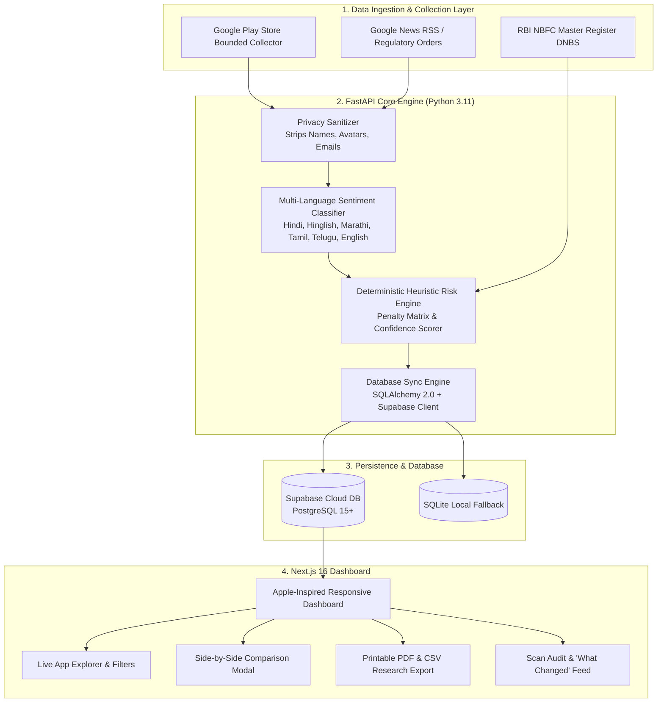

# 🛡️ Loan App Safety Checker

> **Real-Time Regulatory Intelligence & Heuristic Predatory Risk Engine for Digital Lending Applications**  
> Cross-referenced against the official **Reserve Bank of India (RBI) NBFC Master Register (DNBS)** and enriched with multi-language sentiment analysis.

[](https://nextjs.org)
[](https://fastapi.tiangolo.com)
[-3ECF8E?logo=supabase)](https://supabase.com)
[](https://python.org)
[](https://typescriptlang.org)
[](https://opensource.org/licenses/MIT)

---

## 📌 Executive Summary

Illegal and predatory digital lending applications present severe financial cybercrime and extortion risks across mobile marketplaces. Common predatory patterns observed in unauthorized personal loan apps include:
- **7-day & 14-day Tenor Traps:** Advertising 90–365 day terms in the listing while disbursing ultra-short tenure loans with upfront deductions up to 45%.
- **Contact & Gallery Extortion:** Harvesting borrower contact lists, WhatsApp logs, and personal photos to blackmail victims upon non-payment.
- **Obfuscated Ownership & Shell NBFCs:** Disclosing non-existent corporate entities or misappropriating the Certificate of Registration (CoR) of dormant NBFCs.
- **Harassment Networks:** Coercive debt collection agents using automated VoIP spoofing and abusive messaging.

**Loan App Safety Checker** is an evidence-backed intelligence platform that continuously audits active Android digital lending applications. It cross-checks developer identity against the official **Reserve Bank of India (RBI) Register of Non-Banking Financial Companies (NBFCs)**, extracts live user feedback across regional Indian languages, and calculates an explainable, deterministic risk score between **0 and 100**.

> [!IMPORTANT]
> **Heuristic Research Aid:** Assessments are deterministic research signals based on publicly available listing metadata, developer disclosures, and sampled user reviews. They do not constitute formal legal determinations, credit ratings, or certifications of safety.

---

## 🏛️ System Architecture



---

## ✨ Key Features

### 1. Official RBI NBFC Master Register Cross-Referencing
* Every application is verified against the official **Reserve Bank of India Department of Non-Banking Supervision (DNBS)** master database.
* Identifies licensed entities, Registered Digital Lending Apps (DLAs), and unverified shell corporations with official regulatory dates, citations, and status markers.

### 2. Multi-Language Complaint Sentiment Analysis
* Classifies user reviews across English, Hindi, Hinglish, Marathi, Tamil, and Telugu for high-risk predatory triggers:
  * **Contact Harvesting & Privacy Breach:** *Contacts par phone kiya*, *stealing photos*, *calling relatives*.
  * **Short Tenor Trap:** *7 days trap*, *repay in one week*, *tenure false advertising*.
  * **Harassment & Defamation:** *Blackmail*, *threats*, *abusive recovery agents*.
  * **Exorbitant Interest & Hidden Charges:** *40% deducted processing fee*, *high penalty*.

### 3. Separation of Risk Score from Epistemic Confidence
* Prevents the common pitfall where newly released scam apps with zero reviews appear "safe" ($0$ risk).
* Employs an independent **Evidence Sufficiency Score ($0.0 - 1.0$)**. Apps with insufficient review depth are explicitly flagged as **`Insufficient evidence`** rather than declared safe.

### 4. Strict Delisted Application Enforcement
* Apps that are banned, suspended under MeitY Section 69A IT Act orders, or removed by Google Play are completely purged from the active catalog to maintain data integrity.

### 5. Investigative Tooling & Exports
* **Side-by-Side Comparison:** Compare up to 4 loan applications simultaneously across safety scores, permissions, and developer legitimacy.
* **Formatted PDF Dossier:** One-click generation of interview- and court-ready printable investigative dossiers with full citation trees.
* **Raw CSV Export:** Export complete structured audit datasets for further data science and forensic research.
* **Scan History ("What Changed"):** Delta tracking monitoring newly listed apps, score fluctuations, and listing status updates between successive sweeps.

---

## 📊 Deterministic Risk Scoring Formula

The risk score is a deterministic, bounded value between **0.0 (Minimal risk signals)** and **100.0 (High concern / predatory signals)**:

$$\text{Risk Score} = \min\left(100, \; \sum_{i} W_i \cdot P_i\right)$$

### Penalty Matrix Weights ($W_i$)

| Signal Category | Weight | Description |
| :--- | :---: | :--- |
| **Abusive Debt Collection / Harassment** | `35 pts` | Review evidence of contact list blackmail, defamation, or death threats. |
| **Short Tenor / 7-Day Repayment Trap** | `25 pts` | Reviews or terms disclosing sub-60 day repayment with coercive rollovers. |
| **Unverified / Missing NBFC License** | `20 pts` | Developer fails to link to an RBI-registered NBFC or DLA partnership. |
| **Exorbitant Upfront Deduction** | `15 pts` | Processing fees exceeding 20% deducted prior to disbursement. |
| **Intrusive Permissions** | `10 pts` | Requesting `READ_CONTACTS`, `READ_CALL_LOG`, or `READ_MEDIA_IMAGES`. |
| **Store Metadata Discrepancy** | `5 pts` | Generic Gmail/ProtonMail developer contact or missing official privacy policy. |

### Confidence Metric Formula

$$\text{Confidence} = \min\left(1.0, \; \frac{N_{\text{reviews}}}{50}\right) \times 0.7 + \text{MetadataCompleteness} \times 0.3$$

* $\text{Confidence} \ge 0.70$: **High Evidence Depth**
* $0.40 \le \text{Confidence} < 0.70$: **Moderate Evidence**
* $\text{Confidence} < 0.40$: **Insufficient Evidence** (Categorized as *Needs More Data*)

---

## 🛠️ Technology Stack

| Component | Technologies |
| :--- | :--- |
| **Frontend Framework** | **Next.js 16** (App Router, Server & Client Components) |
| **Language & Typing** | **TypeScript 5.x**, strict mode enabled |
| **Styling & Design System** | **Tailwind CSS v4** + `@tailwindcss/postcss`, Apple SF Pro-inspired Glassmorphism |
| **Backend API** | **FastAPI** (Python 3.11+), **Pydantic v2**, Uvicorn ASGI |
| **Database & ORM** | **Supabase (PostgreSQL 15+)** via `@supabase/supabase-js`, **SQLAlchemy 2.0** + **Alembic** |
| **Icons & Visualization** | **Lucide Icons**, **Recharts** |
| **Collection & Parsing** | `google-play-scraper`, `httpx`, `BeautifulSoup4`, regex pattern lexicons |
| **Testing & Quality** | `pytest`, `pytest-asyncio`, `ruff` |

---

## 🚀 Quickstart & Installation

### Prerequisites
* **Node.js 20.9+** and **npm**
* **Python 3.11+**
* Supabase project credentials (or local SQLite)

---

### 1. Frontend Setup (Next.js 16)

```bash
# Navigate to frontend directory
cd frontend

# Install dependencies
npm install

# Configure environment variables
cp .env.example .env.local
```

Edit `frontend/.env.local`:
```env
NEXT_PUBLIC_API_BASE_URL=http://localhost:8000
NEXT_PUBLIC_SUPABASE_URL=https://your-project.supabase.co
NEXT_PUBLIC_SUPABASE_ANON_KEY=your-supabase-publishable-key
NEXT_PUBLIC_USE_SUPABASE=true
```

Run the development server:
```bash
npm run dev
```
Open **[http://localhost:3000](http://localhost:3000)** in your browser.

---

### 2. Backend Setup (FastAPI & Python 3.11)

```bash
# Navigate to backend directory
cd backend

# Create and activate Python virtual environment
python3 -m venv .venv
source .venv/bin/activate  # On Windows: .venv\Scripts\activate

# Install dependencies
pip install -r requirements.txt -r requirements-dev.txt

# Configure environment variables
cp .env.example .env

# Run database migrations
alembic upgrade head

# Run an initial scan to populate live data
python ../scripts/run_scan.py

# Start FastAPI server
uvicorn app.main:app --reload --port 8000
```
- API Base URL: `http://localhost:8000`
- Interactive OpenAPI Swagger Docs: `http://localhost:8000/docs`
- Health Check: `http://localhost:8000/health`

---

## 🗄️ Supabase Database Setup

To initialize the schema in Supabase, execute the following SQL in your Supabase SQL Editor:

```sql
-- 1. Applications table
CREATE TABLE IF NOT EXISTS public.apps (
    package_id TEXT PRIMARY KEY,
    title TEXT NOT NULL,
    developer TEXT NOT NULL,
    developer_email TEXT,
    developer_website TEXT,
    icon_url TEXT,
    store_url TEXT,
    category TEXT DEFAULT 'Finance',
    score NUMERIC(3, 2) DEFAULT 0.0,
    ratings_count INTEGER DEFAULT 0,
    reviews_count INTEGER DEFAULT 0,
    installs_exact INTEGER DEFAULT 0,
    content_rating TEXT,
    privacy_policy_url TEXT,
    store_status TEXT DEFAULT 'active',
    is_active BOOLEAN DEFAULT true,
    first_seen_at TIMESTAMPTZ DEFAULT NOW(),
    last_seen_at TIMESTAMPTZ DEFAULT NOW(),
    updated_at TIMESTAMPTZ DEFAULT NOW()
);

-- 2. Assessments table
CREATE TABLE IF NOT EXISTS public.assessments (
    id UUID PRIMARY KEY DEFAULT gen_random_uuid(),
    package_id TEXT REFERENCES public.apps(package_id) ON DELETE CASCADE,
    overall_score NUMERIC(5, 2) NOT NULL,
    risk_category TEXT NOT NULL,
    confidence_score NUMERIC(4, 3) NOT NULL,
    confidence_level TEXT NOT NULL,
    rationale TEXT,
    indicators JSONB DEFAULT '[]'::jsonb,
    complaint_theme_distribution JSONB DEFAULT '{}'::jsonb,
    evidence_count INTEGER DEFAULT 0,
    engine_version TEXT NOT NULL DEFAULT 'v1.1.0',
    assessed_at TIMESTAMPTZ DEFAULT NOW()
);

-- 3. Scan runs audit log
CREATE TABLE IF NOT EXISTS public.scan_runs (
    id UUID PRIMARY KEY DEFAULT gen_random_uuid(),
    started_at TIMESTAMPTZ DEFAULT NOW(),
    completed_at TIMESTAMPTZ,
    status TEXT NOT NULL DEFAULT 'running',
    trigger_type TEXT DEFAULT 'manual',
    apps_observed_count INTEGER DEFAULT 0,
    apps_new_count INTEGER DEFAULT 0,
    apps_refreshed_count INTEGER DEFAULT 0,
    collector_version TEXT DEFAULT 'v1.1.0',
    error_message TEXT
);

-- 4. Enable Row Level Security (RLS) with Public Read Access
ALTER TABLE public.apps ENABLE ROW LEVEL SECURITY;
ALTER TABLE public.assessments ENABLE ROW LEVEL SECURITY;
ALTER TABLE public.scan_runs ENABLE ROW LEVEL SECURITY;

CREATE POLICY "Allow public read access to apps" ON public.apps FOR SELECT USING (true);
CREATE POLICY "Allow public read access to assessments" ON public.assessments FOR SELECT USING (true);
CREATE POLICY "Allow public read access to scan_runs" ON public.scan_runs FOR SELECT USING (true);
```

---

## 🧪 Testing & Verification

Run backend unit and integration test suites (using 100% mocked external calls):
```bash
cd backend
pytest -v
```

Run static analysis and linting:
```bash
cd backend
ruff check app tests
```

Validate frontend production build:
```bash
cd frontend
npm run build
```

---

## 🔒 Privacy & Cybersecurity Safeguards

1. **PII Stripping:** Reviewer usernames, email IDs, IP addresses, and avatar URLs are purged before scoring or database insertion.
2. **Rate Limiting & Jitter:** Collector requests employ randomized delays ($1.5s - 4.0s$), bounded app query caps, and exponential backoff to respect Google Play terms.
3. **Protected Triggers:** Scan ingestion endpoints require constant-time HTTP Bearer token authentication (`ADMIN_API_TOKEN`).
4. **Content-Hash Deduplication:** External news citations and reviews are keyed by SHA-256 hashes to prevent replay or redundant storage.

---

## 📄 License & Attribution

This project is open-source under the [MIT License](LICENSE).  
Cross-referenced data includes public records published by the **Reserve Bank of India (DNBS)** under the Fair Dealing provisions of the Indian Copyright Act for investigative research and consumer protection.
