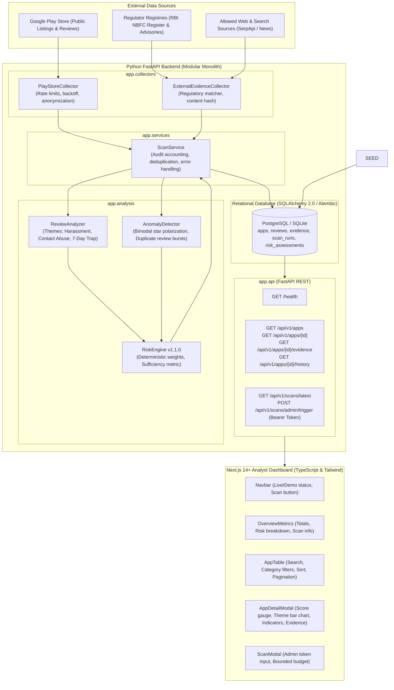

# System Architecture & Component Boundaries

The **Loan App Safety Checker** platform is built as a modular monolith with decoupled data collection, persistence, deterministic analysis, REST API delivery, and a Next.js analyst dashboard.

---

## 1. System Component Diagram

---

## 2. System Boundaries & Invariants

1. **No Frontend Scraping:** Web scraping or collection calls are **never executed inside a user-facing HTTP request**. The Next.js frontend only reads persisted historical snapshots from PostgreSQL via FastAPI.
2. **Deterministic Analysis:** The scoring engine computes scores using pure mathematical functions (`backend/app/analysis/risk.py`). Given the same inputs, the engine outputs the identical score, confidence level, and indicator list.
3. **Data Minimization:** Reviewer identities (names, email addresses, profile avatars) are stripped before persistence to respect privacy.
4. **Graceful Degradation:** If live collection or external search keys are absent, the application functions cleanly using pre-packaged labeled benchmark data and public regulatory lists.
