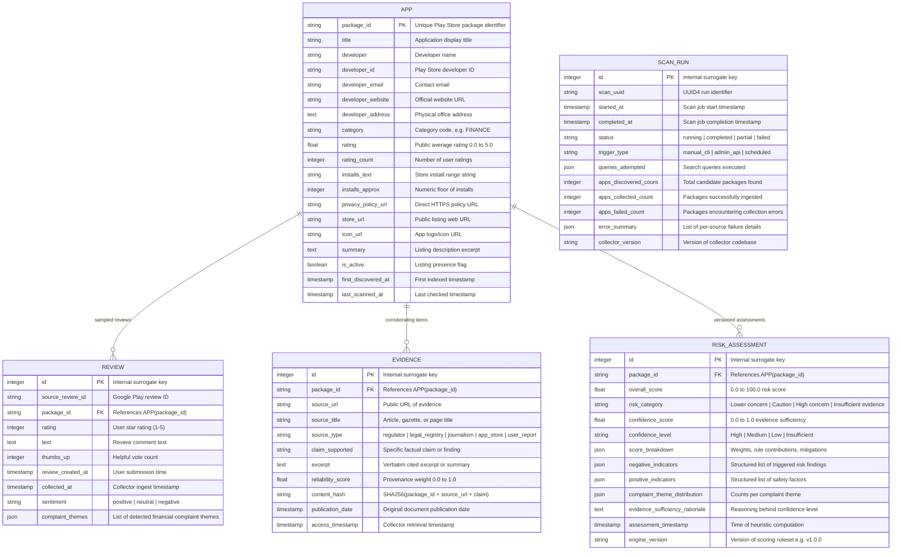

# Database Schema & Data Models

This document defines the relational database schema, tables, column types, relationships, indexes, unique constraints, and migration strategies for the Loan App Safety Checker platform.

---

## 1. Schema Diagram (ERD)



---

## 2. Table Specifications & Constraints

### `apps`
- **Primary Key:** `package_id` (`VARCHAR(255)`). Stable, unique identifier across all Android applications.
- **Indexes:**
  - `ix_apps_package_id` (Unique index on PK)
  - `ix_apps_title` (B-Tree for search queries)
  - `ix_apps_developer` (B-Tree for developer aggregation)
  - `ix_apps_developer_id` (B-Tree for multi-app developer lookups)
  - `ix_apps_category` (B-Tree for category filtering)
  - `ix_apps_rating` (B-Tree for rating range filtering)
  - `ix_apps_last_scanned` (B-Tree for staleness detection)
- **Constraints:** `rating >= 0.0 AND rating <= 5.0`, `rating_count >= 0`.

### `reviews`
- **Primary Key:** `id` (`INTEGER`, autoincrement).
- **Foreign Key:** `package_id` references `apps.package_id` with `ON DELETE CASCADE`.
- **Indexes:**
  - `ix_reviews_package_id` (Foreign key index)
  - `ix_reviews_package_rating` (`package_id`, `rating`) composite index for quick filtering of 1-star vs 5-star reviews.
  - `ix_reviews_source_review_id` (Lookup by upstream review ID).
- **Privacy Minimization:** Reviewer names, email addresses, and profile avatar images are strictly discarded prior to persistence.

### `evidence`
- **Primary Key:** `id` (`INTEGER`, autoincrement).
- **Foreign Key:** `package_id` references `apps.package_id` with `ON DELETE CASCADE`.
- **Unique Constraint:** `uq_app_evidence_hash` (`package_id`, `content_hash`). Prevents duplicate citations of identical evidence while allowing re-scans.
- **Indexes:**
  - `ix_evidence_package_id`
  - `ix_evidence_source_type` (`regulator`, `journalism`, etc.)
  - `ix_evidence_content_hash`

### `risk_assessments`
- **Primary Key:** `id` (`INTEGER`, autoincrement).
- **Foreign Key:** `package_id` references `apps.package_id` with `ON DELETE CASCADE`.
- **Indexes:**
  - `ix_risk_assessments_package_id`
  - `ix_risk_assessments_category` (`High concern`, `Caution`, etc.)
  - `ix_risk_assessments_timestamp` (Ordering by latest assessment)
- **Data Integrity:** Historical assessments are preserved immutably. Re-scoring an app creates a new row with the current timestamp and engine version, providing an audit trail.

### `scan_runs`
- **Primary Key:** `id` (`INTEGER`, autoincrement).
- **Unique Constraint:** `scan_uuid` (`VARCHAR(64)`).
- **Indexes:**
  - `ix_scan_runs_status`
  - `ix_scan_runs_started_at`

---

## 3. Database Migration Strategy (Alembic)

Database schema evolution is managed with Alembic.
- **Dual Support:** The schema definitions in `backend/app/db/models.py` use standard SQLAlchemy 2.0 constructs compatible with both PostgreSQL in production and SQLite for local development and CI testing.
- **Async Execution:** FastAPI uses `create_async_engine` (`asyncpg` for PostgreSQL, `aiosqlite` for SQLite).
- **Migration Commands:**
  ```bash
  # Generate migration after model changes
  alembic revision --autogenerate -m "description_of_changes"

  # Apply all pending migrations
  alembic upgrade head

  # Rollback one migration
  alembic downgrade -1
  ```
