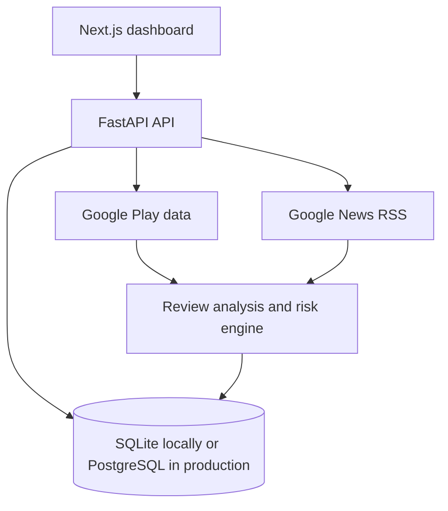

# Architecture Interview Notes

## Components

## Why this design

The frontend stays simple and displays API results. The backend performs work that needs secrets, rate limits, retries, and database access. This prevents sensitive configuration from being shipped to the browser.

## Production setup

| Component | Hosting |
| --- | --- |
| Next.js frontend | Vercel |
| FastAPI backend | Render or Railway |
| Database | Managed PostgreSQL |

The frontend requires `NEXT_PUBLIC_API_BASE_URL`. The backend requires a production database URL, a strong scan token, and a CORS allowlist containing the Vercel domain.

## Scaling answer

For more frequent or larger scans, replace in-process background tasks with a queue worker. Add scheduled jobs, a shared cache, source-specific rate limits, and an evidence-review workflow. Keep API reads separate from long-running collection jobs.

## Trade-offs

- Keyword discovery is practical but cannot prove complete Play Store coverage.
- Deterministic scoring is explainable but cannot understand every language nuance.
- Public news links add context but cannot be treated as regulatory verification.
- SQLite makes local setup easy; PostgreSQL is the production choice for concurrent access.
