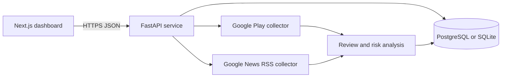

# Loan App Safety Checker Interview Guide

## Project summary

Loan App Safety Checker is a research dashboard for public Android lending apps. It collects current Google Play listing details, a bounded review sample, and a small set of public news links. It presents a transparent heuristic assessment with a score, a category, evidence coverage, and source links.

The project is a research aid. A low score means the current sample contained fewer matching risk signals. It does not certify that an app is safe or determine whether a lender is legal.

## Problem solved

People evaluating a lending app have to inspect store details, complaints, and external reporting across many places. This project brings that public information together and explains which observable signals influenced the result.

The app looks for themes such as:

- Collection harassment or threats.
- Contact or photo access allegations.
- Short repayment cycles and undisclosed fee deductions.
- Missing secure privacy policy links.
- Review repetition or unusually polarized rating patterns.

## Architecture

### Frontend

The frontend is a Next.js application. It lists assessed apps, supports search and filters, opens one app detail dialog at a time, and launches authenticated scans. The scan dialog polls the API until the background work finishes, then refreshes the results.

The frontend only receives `NEXT_PUBLIC_API_BASE_URL`. Database credentials and the scan token stay on the backend.

### Backend

The FastAPI service exposes:

- `GET /health` for service readiness.
- `GET /api/v1/apps` for the searchable, paginated app catalog.
- `GET /api/v1/apps/{package_id}` for app details and evidence.
- `GET /api/v1/scans/latest` for scan status.
- `POST /api/v1/scans/admin/trigger` for authenticated scan requests.

The scan route starts a background task so the request returns quickly. Each app is collected, analyzed, stored, and counted as the scan continues. The latest scan endpoint reports completion, partial failures, and collected-app counts.

### Data storage

SQLite is used locally for simple setup. PostgreSQL is recommended in production. The key stored records are:

- App listing metadata and developer contact fields.
- De-identified public reviews.
- Search or news evidence with source URLs and access time.
- Versioned risk assessment snapshots.
- Scan runs, including status and errors.

## Collection flow

1. Run several loan-related Google Play search queries.
2. Deduplicate results by package ID.
3. Retrieve listing metadata and a bounded sample of recent reviews.
4. Remove reviewer names, images, and other personal profile fields.
5. Classify review text into defined complaint themes.
6. Detect simple review anomalies, such as repeated text or unusually polarized ratings.
7. Fetch up to three relevant Google News RSS links that name the app brand.
8. Calculate the deterministic risk score and evidence coverage.
9. Save the records and show them in the dashboard.

## Risk model

The score ranges from 0 to 100. Higher values mean more observed risk signals.

| Signal | Maximum score effect |
| --- | ---: |
| Harassment or threats in reviews | +30 |
| Contact or photo access allegations | +25 |
| Short cycle or hidden-fee allegations | +20 |
| Missing secure privacy policy | +15 |
| Review anomaly | +10 |
| Official regulatory advisory | +35 |
| Large adoption with low sampled complaint rate | -10 |
| Verified official regulated entity record | -25 |

Public news and search links are useful investigation leads. They have a reliability score of zero and do not affect the score until an official regulatory record is added.

Risk categories are:

- Lower concern: score below 30 with adequate evidence.
- Caution: score from 30 to below 65.
- High concern: score of 65 or above.
- Insufficient evidence: confidence below 0.35 or too little public information.

## Why confidence is separate from risk

An app with little data should not receive a clean result. Confidence combines review sample size, privacy-policy availability, rating volume, and trusted official evidence. This keeps a low score from being interpreted as proof of safety.

## Security and privacy

- Scan execution requires a bearer token.
- Production tokens, database URLs, and API keys are environment variables.
- CORS allows only the configured frontend domain.
- Reviewer identity fields are not persisted.
- Source URLs are retained so a reviewer can inspect provenance.

## Deployment answer

The production architecture uses Next.js on Vercel, FastAPI on Render or Railway, and PostgreSQL on a managed database service. Vercel must receive `NEXT_PUBLIC_API_BASE_URL` with the deployed HTTPS backend URL. The backend must allow the Vercel domain in `CORS_ORIGINS` and use a strong `ADMIN_API_TOKEN`.

## Known limits and how to explain them

- Google Play discovery is keyword based, so it cannot guarantee every lending app in the store is found.
- Public reviews can be biased or manipulated, so they are signals rather than proof.
- The project does not inspect installed-app permissions or APK behavior.
- Google News is a short public reporting sample and does not cover every complaint or forum discussion.
- The assessment is not financial, legal, or regulatory advice.

## Suggested interview questions

### Why use a deterministic score instead of a machine-learning model?

The project needs explainability. A reviewer can see the rule, the source type, and the contribution to the final score. That is easier to audit than an opaque prediction.

### How do you prevent a review sample from creating a false safety result?

Risk and confidence are separate. Low confidence produces the `Insufficient evidence` category instead of a lower-concern verdict.

### How does the scan work without blocking the UI?

The API accepts the authenticated request and starts a background job. The frontend polls scan status, shows progress, and reloads data only after the job ends.

### How would you scale it?

Move scans to a queue worker, schedule periodic jobs, use PostgreSQL, cache listing metadata, and store source-fetch timestamps. Keep strict request limits and backoff for upstream services.

### What would you improve next?

Add reviewed regulator data feeds, an Android permission or APK analysis service, multilingual review analysis, better entity matching between developers and lenders, and human evidence review workflows.
